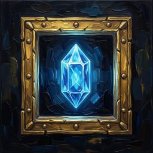
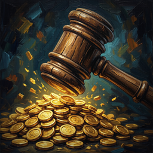
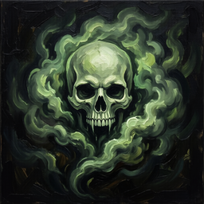

# Benis Addons

An addon index for [SHART](https://github.com/fpcompany/SHART): the World of
Warcraft addons released here on GitHub rather than on CurseForge or Wago.

SHART reads it out of the box. They show up under **Get Addons → Custom
sources**, and copies already in your AddOns folder are recognised by folder
name.

| | Addon | |
| --- | --- | --- |
|  | [BenisUI](https://github.com/fpcompany/BenisUI) | UI overhaul |
|  | [BenisAH](https://github.com/fpcompany/BenisAH) | Auction house scanner |
|  | [SmellyFarts](https://github.com/fpcompany/SmellyFarts) | A sound when an enemy player dies |

## Format

`addons.json`:

```json
{
  "name": "Benis Addons",
  "addons": [
    {
      "repo": "owner/repo",
      "name": "Shown name",
      "author": "Who made it",
      "summary": "One line",
      "folders": ["MainFolder", "MainFolder_Options"],
      "icon": "icons/MainFolder.png"
    }
  ]
}
```

Only `repo` is required. `folders` defaults to the repository's name, and
`icon` is a path relative to this file or a full URL. Each addon repository
publishes GitHub releases with the addon zipped, plus a `release.json` (the
BigWigs packager's format) saying which game flavors the zip is for.

## Adding an addon

Add an entry to `addons.json` and a 256×256 PNG to `icons/`, then commit and
push. SHART picks the change up within ten minutes.

To use another index in SHART, add its `owner/repo` (or the URL of its JSON
file) under Options → Custom sources.
